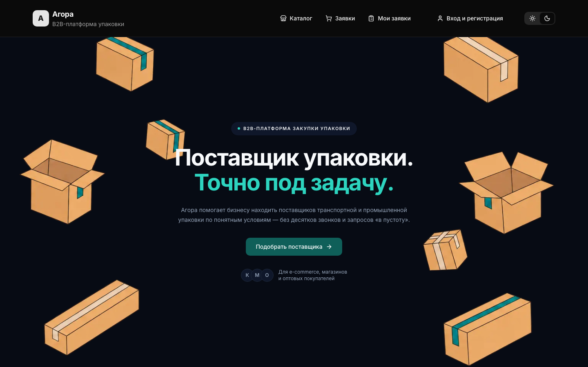
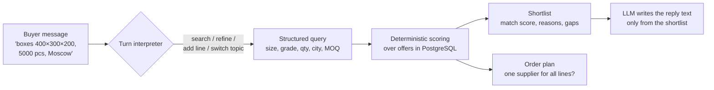

# Agora — AI sourcing for B2B packaging

**Live demo:** [agora-demo-cyan.vercel.app](https://agora-demo-cyan.vercel.app) · **Organisation:** [Agora-hg](https://github.com/Agora-hg) · **Status:** early-stage startup in the *Ya v Dele* and *Innovators of Moscow* accelerators · **My role:** co-founder, frontend developer · **Storefront code:** [sofya0206/agora-demo](https://github.com/sofya0206/agora-demo) (public, with a code walkthrough). The backend is private.

A business that needs 5 000 corrugated boxes usually spends days calling suppliers. Agora lets the buyer describe the task in plain words and returns a shortlist of real suppliers from the catalogue, with an honest match score and a list of what does not fit.

## What Agora is and why it exists

Small and mid-size businesses in Russia (online shops, warehouses, wholesalers) buy packaging all the time: boxes, film, tape, pallets, labels. The market is fragmented. Hundreds of small factories have no proper websites or price lists, so a buyer spends days on calls and still cannot compare offers.

Agora is a marketplace that fixes this:

1. **One catalogue** of verified suppliers and their real offers: sizes, grades, minimum order, lead time and price.
2. **One request instead of ten calls.** The buyer describes the task, gets a ranked shortlist and sends one request. An operator and a Telegram bot pass it to the supplier.
3. **The AI assistant** turns a free-text request into exact parameters and explains why each supplier fits or does not.

**Where we are:** a working product with a pilot in Moscow. We started with 14 packaging categories and corrugated boxes first. We are testing demand with a separate SEO catalogue and collecting supplier leads with our own classifier. The team was selected for two Moscow startup programmes, *Ya v Dele* and *Innovators of Moscow*.

## The AI part: grounded matching, no made-up suppliers

Most "AI search" demos let a language model write the answer. In B2B that is dangerous: the model invents a supplier, a price or a lead time. Agora keeps the model away from the facts.

1. **Turn interpreter.** Each message is classified: small talk, search, refine ("make it brown"), add a line ("and sheets too"), topic switch, reset or sort. Context is kept or dropped accordingly. Product fields such as size are reset on a topic switch, while buyer fields such as city and quantity stay.
2. **Structured query.** The LLM (DeepSeek) only turns text into fields. Without an API key, a rule-based parser does the same job, so matching never depends on the model.
3. **Deterministic scoring in SQL.** The match score is the share of requirements the buyer actually stated that an offer meets. A contradiction such as a wrong size or a minimum order above the quantity blocks an "exact match". Empty supplier cards never win.
4. **Explainability.** Every result shows `match_reasons` and `match_gaps`, plus how many offers were searched, so the UI never pretends the catalogue is bigger than it is.
5. **Multi-line orders.** "Boxes and sheets" is one order with several lines. Agora checks whether a single supplier covers all of them (≥75% on each) and recommends one request instead of four.

## Product

| Service | What it does | Stack |
| --- | --- | --- |
| [Storefront](https://github.com/sofya0206/agora-demo) | Catalogue, supplier finder, request checkout, landing | Next.js 16, React 19, TypeScript |
| API | Catalogue, suppliers, offers, AI sessions with streaming (SSE) | PHP 8.3, Laravel, PostgreSQL |
| Admin panel | Suppliers, offers, AI test bench, LLM cost per chat | React 19, Vite |
| Telegram bot | New requests to the admin, then to the supplier; replies relayed | Python, FastAPI |
| Lead collector | Crawls supplier sites, classifies them as corrugated-packaging makers or not | Python, FastAPI, SQLite |
| SEO catalogue | Separate test product to check search demand in Moscow | Next.js, Drizzle, PostgreSQL |

## Team and my role

I am a **co-founder and the frontend developer**. I wrote the storefront (20 of 21 commits): the catalogue with filters in the URL, a supplier finder that ranks suppliers by how many of the buyer's categories they cover, the request cart and checkout, and the landing page with light and dark themes. The AI matching described above runs in the API. On the storefront it is presented on the landing page, and connecting it to the chat interface is the next step.

- Backend, admin panel, bot and lead collector: [Rauan228](https://github.com/Rauan228)
Agora was selected for two Moscow startup programmes: **Ya v Dele** and **Innovators of Moscow**, where I am a resident of the Innovators Academy.

---

Sofia Guliaeva · [github.com/sofya0206](https://github.com/sofya0206)
